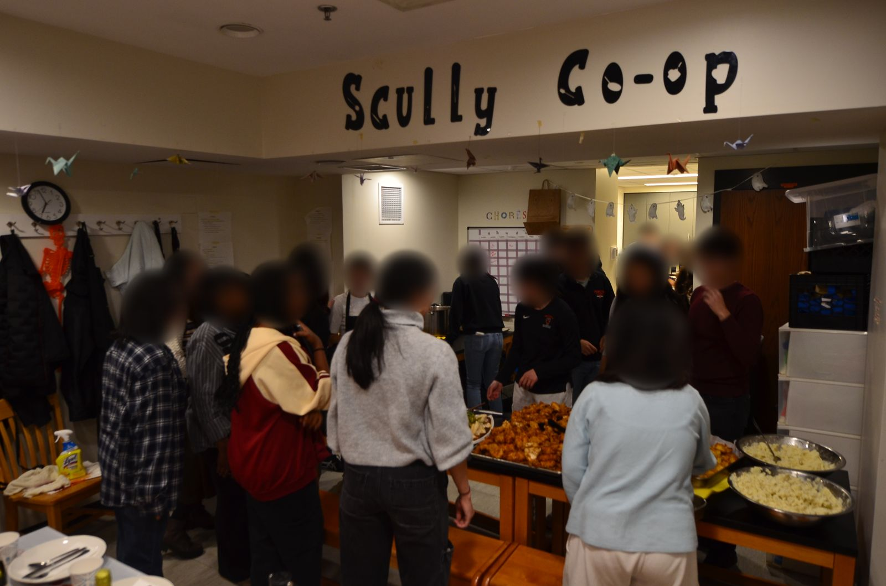
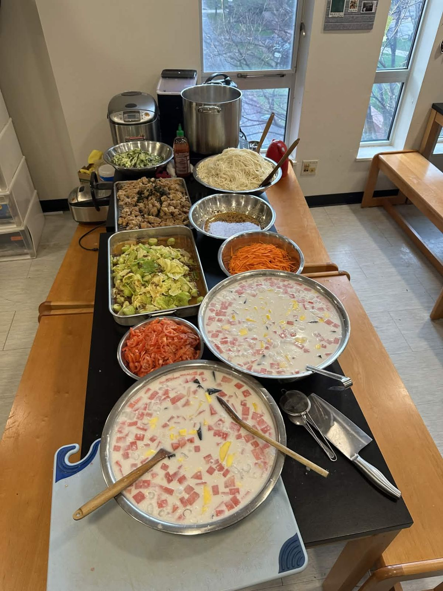
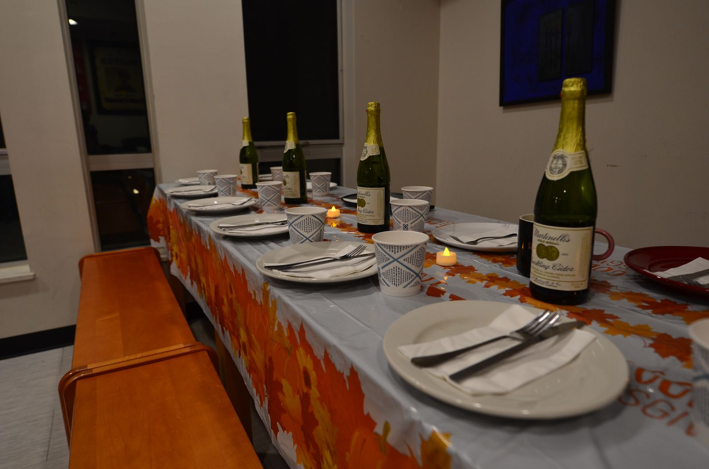
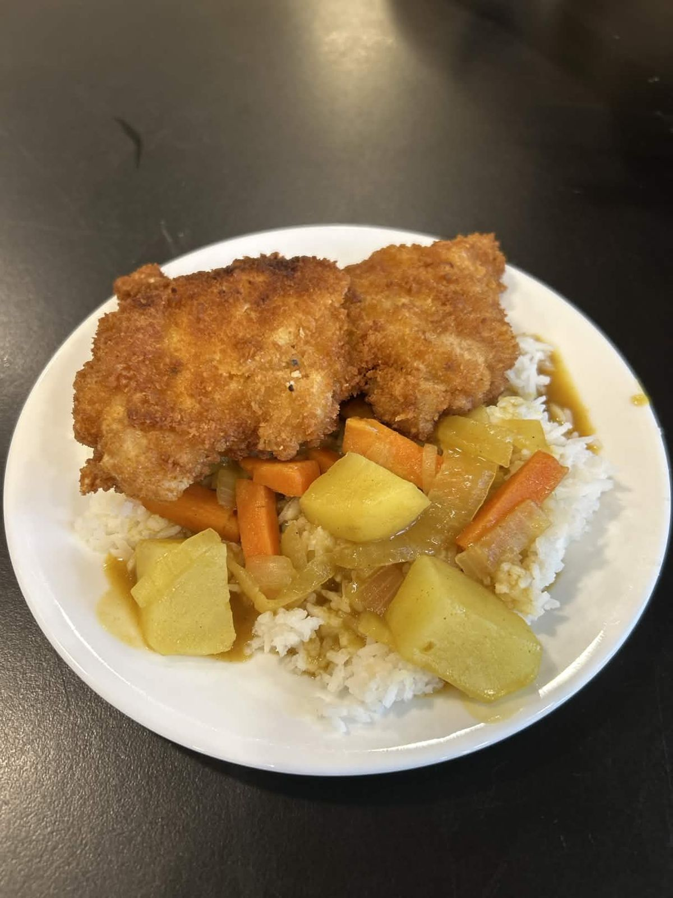
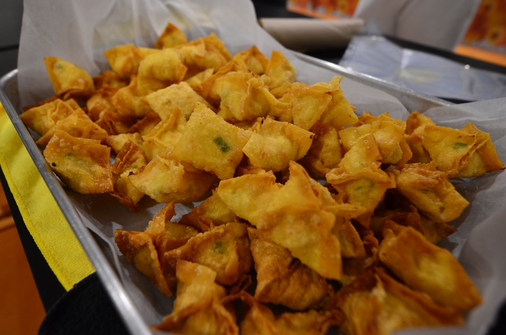
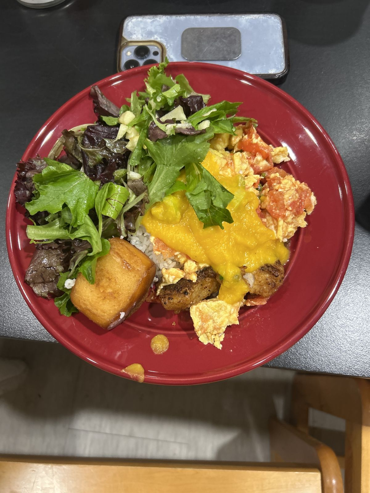

# Nuestra historia

Merkats nació de una comunidad que ya sabía cómo hacer esto.

En Princeton, unirse a una cooperativa de cocina, un grupo de estudiantes que cocinan unos para otros, era una de las opciones de comida disponibles para los estudiantes de los últimos años. En la [Scully Cooperative](https://scullycoop.vercel.app/), una comunidad de unos 35 miembros, siempre había gente cocinando, conversando y limpiando en grupo. Pero una de las partes más difíciles de dirigir una cooperativa era llevar el control de todo.

<figure><figcaption>Acción de Gracias en Scully Co-op</figcaption></figure>

A veces los miembros compraban alimentos por duplicado, los turnos de cocina preparaban demasiada comida y la gente olvidaba marcar sus tareas como hechas. En 2025 intentamos resolver estos problemas con un bot de Discord y comandos personalizados como `/setRecurringPoll` y `/setMenu`, pero no era una interfaz cómoda para todos.

Esa experiencia inspiró Merkats: una app fácil de usar que reúne estas herramientas de seguimiento. Aunque nuestra [app para iOS](https://apps.apple.com/us/app/merkats/id6806871553) ya está disponible en el App Store, todavía estamos en una etapa temprana de desarrollo. Esperamos trabajar con nuevos grupos de cocina para saber qué necesitan y crear funciones que hagan más fácil cocinar en grupo.

Si quieres saber más o darnos tu opinión, [agenda una conversación de 30 minutos con nosotros](https://calendly.com/jchai8985/30min). Nos encantaría saber cómo cocina tu grupo.

**Nuestra visión es crear comunidad a través de la cocina compartida y ofrecer la plataforma que lo haga posible.**

— El equipo de Merkats
