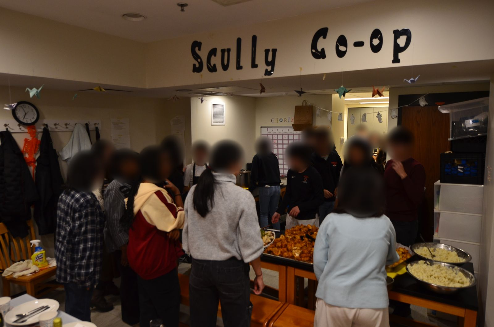
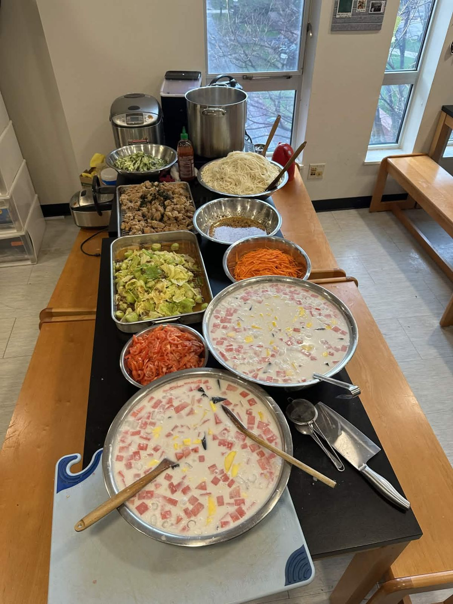
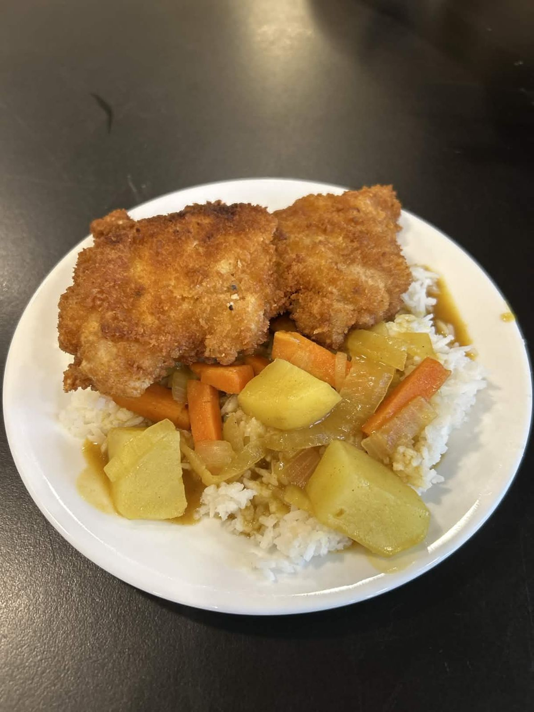
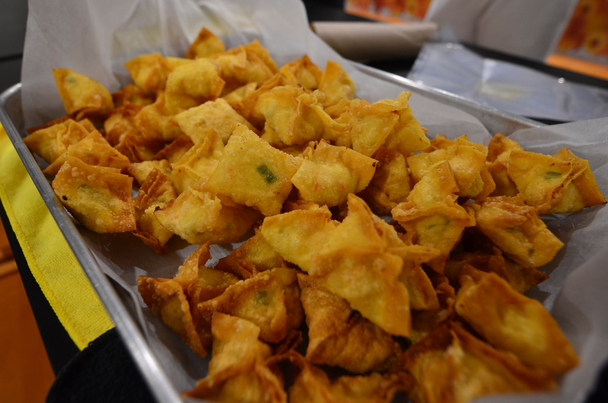
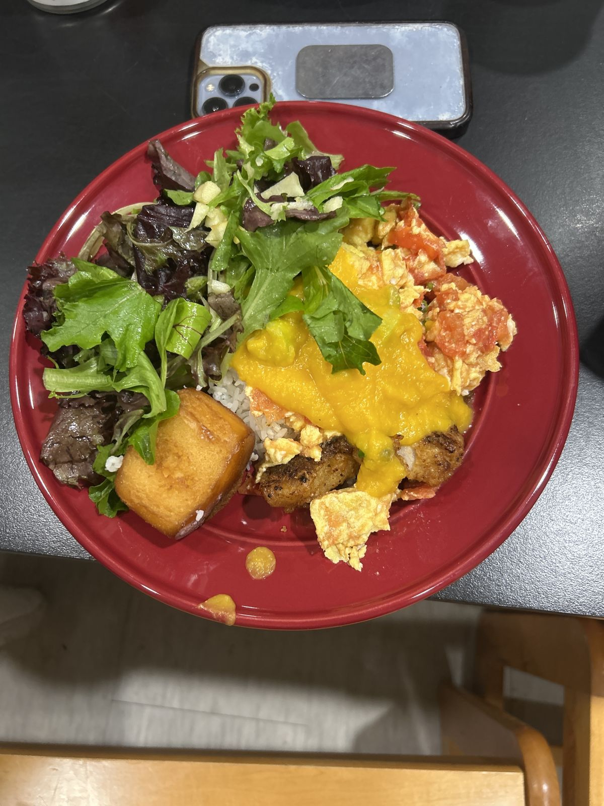

# 我们的故事

Merkats 起源于一个早已懂得如何一起做饭的社区。

在普林斯顿大学，高年级学生可以选择加入烹饪合作社——一群为彼此做饭的学生——作为用餐方式之一。在约有 35 名成员的 [Scully Cooperative](https://scullycoop.vercel.app/)，大家总是一起做饭、聊天和打扫。但经营合作社最困难的部分之一，就是掌握所有事情的进度。

<figure><figcaption>Scully Co-op 的感恩节</figcaption></figure>

成员有时会重复购买食材，轮班做饭的人会做得太多，也有人忘记确认已完成的家务。2025 年，我们尝试用 Discord 机器人和 `/setRecurringPoll`、`/setMenu` 等自定义命令来解决这些问题，但这种界面并不适合每个人。

这段经历催生了 Merkats：一款简单易用的应用，把这些追踪工具集中在一起。虽然我们的 [iOS 应用](https://apps.apple.com/us/app/merkats/id6806871553)已经在 App Store 上架，但我们仍处于早期开发阶段。我们希望与新的烹饪小组合作，了解他们的需求，并开发出让一起做饭变得更轻松的功能。

如果你想了解更多或分享反馈，欢迎[预约与我们进行 30 分钟的交流](https://calendly.com/jchai8985/30min)。我们很想听听你的小组是如何一起做饭的。

**我们的愿景是通过共同烹饪建立社区，并提供实现这一愿景的平台。**

— Merkats 团队
